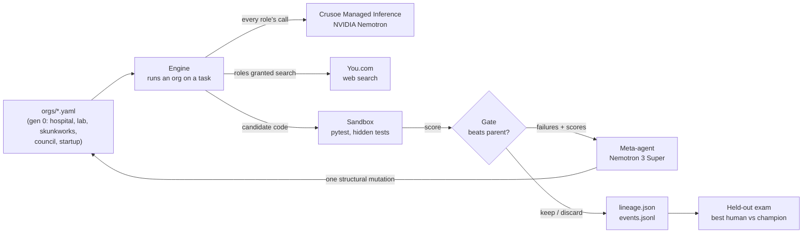

# Darwin Inc.

**Human org charts are generation zero. Agent teams start as a teaching hospital, a research lab and a startup, then evolve organizational structures no human company would design, keeping a change only if it wins on tasks the team has never seen.**


**What it does**
- **Org charts as code, not just one boss.** An organization is a YAML file: one or more teams (isolated or connected), each with its own pipeline of roles, plus a governance rule for how the final answer is chosen: evidence (tests), a single leader, a council of peers that votes, or a router that splits the work across divisions. Flat, functional, divisional, matrix, skunkworks and leaderless councils are all expressible. Swap the file and you get a different company running on the same model.
- **Human orgs as the starting population.** A teaching hospital (inspired by Cockroach Labs' [MOLT Sinai](https://www.cockroachlabs.com/blog/experiment-running-hospital-code/)), a university research lab, a Lockheed-style skunkworks, a leaderless council of peers, and a one-person startup baseline. A catalog adds the four textbook structures.
- **Fair, hidden grading.** Every org fixes the same vague one-line software issues. A pytest grader scores the result with hidden tests the agents never see.
- **Evolution past the human baseline.** A Nemotron meta-agent reads where each org failed and proposes one structural mutation, from a role tweak to reshaping the whole company: spin off a skunkworks, fork a team to compete with itself, dissolve a team, switch from a leader to a council or a router, or use options no human company would: blind reviewers, disposable parallel clones, instant shared memory. A mutant survives only if it beats its parent.
- **Catches itself looping.** If an implementer resubmits work it already tried, or send-backs hit the round limit, a circuit breaker trips and the org either ships its best work or pages a human (`page_human` events), exactly as its YAML says.
- **Walk away.** Start one command; it evolves, gates, and finishes with a held-out exam on tasks evolution never saw. Budget caps, Ctrl-C and API failures all end in saved results, and `--resume` continues a stopped run.

**Results**

> Pending the first live run on Crusoe. This table is filled only from `runs/<id>/final.json`; no number here is estimated.

| Org | Structure | Train score | Held-out score | Cost |
|---|---|---|---|---|
| `flat_startup` (baseline) | engineer | pending | pending | pending |
| `crusoe_general` (hospital) | triage+search → fellow → attending → discharge | pending | pending | pending |
| `research_lab` | pi+search → undergrad → grad students ×3 → pi pick → lab meeting | pending | pending | pending |
| `skunkworks` | main division (spec → engineer → review) \| isolated skunkworks (builder+search) ⇒ tests decide | pending | pending | pending |
| `council_of_peers` | 3 independent partners ⇒ council of 3 votes | pending | pending | pending |
| **Evolved champion** | pending | pending | pending | pending |



**Quick links:** [Try it](#try-it) · [How it works](#how-it-works) · [The seed orgs](#the-seed-orgs) · [Org shapes](#org-shapes-beyond-one-boss) · [Mutations](#mutation-menu) · [Crusoe + Nemotron](#crusoe-and-nvidia-nemotron) · [You.com](#youcom) · [For AI agents](#for-ai-agents) · [Honest limits](#status-and-honest-limits)

---

## Contents

- [Try it](#try-it)
- [For AI agents](#for-ai-agents)
- [How it works](#how-it-works)
- [The seed orgs](#the-seed-orgs)
- [Org shapes beyond one boss](#org-shapes-beyond-one-boss)
- [Mutation menu](#mutation-menu)
- [The tasks](#the-tasks)
- [Crusoe and NVIDIA Nemotron](#crusoe-and-nvidia-nemotron)
- [You.com](#youcom)
- [Repo map](#repo-map)
- [Environment variables](#environment-variables)
- [Glossary](#glossary)
- [Status and honest limits](#status-and-honest-limits)
- [Built at the hackathon](#built-at-the-hackathon)

---

## Try it

1. **Run the plumbing offline (no keys).** A fake model drives the whole pipeline so you can see every stage and the event log.
   ```bash
   pip install -r requirements.txt
   DARWIN_MOCK=1 python run.py evolve --generations 1 --children 1
   ```
2. **Add your key and check it.** The key goes in `.env`, which git ignores, so it can never be committed.
   ```bash
   cp .env.example .env        # then paste your key after CRUSOE_API_KEY=
   python run.py check         # key works? Nemotron models found?
   python run.py spend         # estimated credits used and caps left
   ```
   Two caps protect your credits: `DARWIN_BUDGET` stops a single run, and `DARWIN_TOTAL_BUDGET` stops all runs combined (tracked in `runs/.spend.json`). Spend is estimated from token counts; the Crusoe console shows what was actually billed.
3. **Watch one org work one task.**
   ```bash
   python run.py once --org hospital --task median
   ```
4. **Compare the human orgs, then walk away.**
   ```bash
   python run.py compare --split train
   python run.py compare --orgs "orgs/catalog/*.yaml"     # flat, functional, divisional, matrix
   DARWIN_BUDGET=5 python run.py evolve --generations 3 --children 2
   ```

5. **Run the test suite (offline, about 40 s).**
   ```bash
   python -m pytest tests -q
   ```

Every run writes `runs/<id>/`: `meta.json` (live or mock, models, settings), `events.jsonl` (every handoff, rejection, breaker trip and score, replayable without any model call), `lineage.json` (every org tried, its parent, its mutation, kept or discarded), `orgs/*.yaml` (each mutant as a runnable file) and `final.json` (held-out exam).

---

## For AI agents

| Need | Where |
|---|---|
| Run an org on a task | [`darwin/engine.py`](darwin/engine.py) (`run`) |
| Org schema and validation | [`darwin/org.py`](darwin/org.py) |
| Mutations and meta-agent | [`darwin/evolve.py`](darwin/evolve.py) (`OPS`, `apply`, `meta_mutation`) |
| Scoring across tasks and seeds | [`darwin/evaluate.py`](darwin/evaluate.py) |
| Model calls, cost ledger, budget cap, mock | [`darwin/llm.py`](darwin/llm.py) |
| Web search tool | [`darwin/search.py`](darwin/search.py) |
| Isolated test runs | [`darwin/sandbox.py`](darwin/sandbox.py) |
| CLI | [`run.py`](run.py) |
| Frozen prompts (never edited by evolution) | [`prompts/`](prompts) |
| Hidden tests (never shown to agents) | `tasks/*/*/hidden_test.py` |

Rules: evolution may change structure only, never `prompts/`. Agents never see `hidden_test.py` or `reference/`.

---

## How it works

### One task, one org

All of an org's teams start on the task in parallel (or, under `router` governance, a dispatcher first assigns it to one team). Each team runs its own pipeline:

| # | Stage kind | What happens | Model |
|---|---|---|---|
| 1 | `spec` | Writes the team's definition of done as pytest tests from a vague one-line issue | Nemotron 3.5 Lightning |
| 2 | `plan` | Sets direction for implementers (a PI, a design lead) | Nemotron 3.5 Lightning |
| 3 | `implement` | Rewrites the module; `parallel: N` runs N independent attempts concurrently | Nemotron 3.5 Lightning |
| 4 | `select` | Picks one candidate, by team tests or by an LLM judge | tests or Nemotron |
| 5 | `review` | Verdict APPROVE/REJECT; with `can_veto`, a rejection sends work back. A `blind` reviewer sees tests and results but never the code. `voters: N` with `rule: majority\|unanimous` makes it a panel instead of one boss | Nemotron 3.5 Lightning |
| 6 | `verify` | Runs the team's own tests in the sandbox; failure sends work back | none (pytest) |
| 7 | decide | With several teams, governance picks one answer: `tests` (most of everyone's tests passed), `leader` (one judge), `council` (N peers vote, tests break ties) | tests or Nemotron |
| 8 | grade | Hidden tests score the final code, 0 to 1 | none (pytest) |

Send-backs count as rounds. The circuit breaker trips when `max_rounds` is reached or when an implementer resubmits code it already tried (a loop). The org then either `escalate`s (stops and pages a human) or `ship`s the best so far.

<details>
<summary><b>Evolution loop</b></summary>

1. Score every seed org on the train tasks (generation 0).
2. Take the top `--parents` orgs. For each, the meta-agent (Nemotron 3 Super) reads its scorecard, its failure notes and every mutation already tried, then proposes exactly one structural change from the menu. Invalid proposals fall back to a random valid mutation, so evolution never stalls.
3. Score the mutant on the same train tasks. It joins the population only if it beats its parent (or ties at under 80% of the cost).
4. Repeat for `--generations`, or until the budget cap.
5. Held-out exam: the best human org, the evolved champion and the startup baseline are re-scored on tasks evolution never saw, with `--final-seeds` repeats.
</details>

<details>
<summary><b>Why the comparison is fair</b></summary>

- Prompts are per kind of work and shared by every org. Org names like "attending" or "grad student" are labels; the attending and a mutant's reviewer get the same review prompt. Score differences come from structure.
- Every org gets the same tasks, the same hidden tests, the same model and the same budget rules.
- Selection uses train tasks; the headline number uses held-out tasks.
- Code always runs in a separate process with a timeout, never inside the engine.
</details>

---

## The seed orgs

| Org | Structure | Human analogue |
|---|---|---|
| [`crusoe_general`](orgs/hospital.yaml) | triage (spec, search) → fellow → attending (veto) → discharge (verify); 4 rounds then escalate | Teaching hospital: mandatory definition of done, second opinion, discharge audit |
| [`research_lab`](orgs/lab.yaml) | PI direction (search) → undergrad (tests) → 3 grad students in parallel → PI picks → lab meeting (verify); shared memory; 2 rounds then ship | University lab: parallel exploration, shared findings |
| [`skunkworks`](orgs/skunkworks.yaml) | main division: requirements → engineer → design review \| isolated skunkworks: one builder with search; the answer passing the most of everyone's tests wins | Lockheed Skunk Works: a small secret team outside the hierarchy |
| [`council_of_peers`](orgs/council.yaml) | three partners work alone; a council of three votes; one partner's work also faces a 3-person majority panel | Partnership / oligarchy: no single leader |
| [`flat_startup`](orgs/startup.yaml) | one engineer, no review | Baseline: does structure help at all? |

---

## Org shapes beyond one boss

The model does not assume a single CEO. An org is any number of teams plus a governance rule, so the classic textbook structures are just files ([`orgs/catalog/`](orgs/catalog)):

| Structure | How Darwin expresses it | File |
|---|---|---|
| **Flat** | General manager over two project teams; each PM plans and picks between two employees; the GM picks between projects (`decide: leader`) | [`flat.yaml`](orgs/catalog/flat.yaml) |
| **Functional** | One pipeline through departments: requirements → R&D → QA → CEO sign-off | [`functional.yaml`](orgs/catalog/functional.yaml) |
| **Divisional** | Self-contained divisions with their own functions and a `focus`; a dispatcher routes each issue to ONE division (`decide: router`), so divisions split work instead of duplicating it | [`divisional.yaml`](orgs/catalog/divisional.yaml) |
| **Matrix** | Dual reporting: the engineer's work needs both the functional manager (reads the code) and the project manager (blind, accepts only against the definition of done); either can send it back | [`matrix.yaml`](orgs/catalog/matrix.yaml) |
| **Skunkworks** | An isolated team that sees nothing from the main division, competing on evidence | [`skunkworks.yaml`](orgs/skunkworks.yaml) |
| **Oligarchy / partnership** | Peer teams and a voting council, no leader | [`council.yaml`](orgs/council.yaml) |

Run them head to head with `python run.py compare --orgs "orgs/catalog/*.yaml"`, or seed evolution with any mix: `python run.py evolve --orgs "orgs/**/*.yaml"`.

Evolution can move between these shapes on its own: `add_skunkworks` and `fork_team` turn a one-team org into a multi-team one, `set_governance` switches between tests, leader, council and router, `toggle_isolated` connects or cuts off a team, and `remove_team` dissolves one.

One honest note on matrix: human matrices exist mostly to share scarce specialists between projects. Agent specialists are not scarce (they can be cloned), so in Darwin the matrix reduces to its other defining feature, dual reporting.

---

## Mutation menu

| Mutation | Non-human? | Effect |
|---|---|---|
| `add_review` | | Reviewer with veto after implementation |
| `add_blind_review` | yes | Reviewer who judges tests and evidence but never sees the code |
| `set_parallel` (1, 3, 5) | yes | Disposable clones race on the same task; a selector keeps one |
| `toggle_shared_memory` | yes | Every role in every connected team sees every finding instantly |
| `set_panel` (1, 3, 5; majority or unanimous) | | Turn one reviewer into a voting panel |
| `add_skunkworks` | | Spin up a small isolated team (one builder with search) |
| `fork_team` | yes | Clone a team as an isolated competitor of itself |
| `remove_team`, `toggle_isolated` | | Dissolve a team; cut it off from or reconnect it to shared findings |
| `set_governance` (tests, leader, council, router) | | Change how the organization decides, or turn competing teams into divisions |
| `toggle_search` | | Grant or remove You.com search for a role |
| `toggle_blind`, `toggle_veto` | | Change what a reviewer sees or whether it can send work back |
| `add_spec`, `add_verify` | | Definition of done first; run the team's own tests before shipping |
| `remove_stage` | | Delete a role |
| `set_max_rounds`, `flip_breaker` | | Loop limit; escalate to a human vs ship best so far |

---

## The tasks

Each task is a vague one-line issue, a buggy starter module and hidden tests that encode what a careful engineer would expect (edge cases, invalid input, not mutating arguments).

| Split | Tasks |
|---|---|
| Train (6) | `slugify`, `parse_duration`, `merge_intervals`, `median`, `luhn`, `query_string` |
| Held-out (4) | `roman`, `word_wrap`, `semver`, `isbn` |

`semver` and `isbn` follow external specifications, where a role with web search has a real advantage. Every reference solution passes 100% of its hidden tests and every starter fails some; the check is in the repo history.

---

## Crusoe and NVIDIA Nemotron

All model calls go to Crusoe Managed Inference's OpenAI-compatible endpoint (`https://api.inference.crusoecloud.com/v1`).

| Role | Model | Why |
|---|---|---|
| Every org role | `nvidia/Nemotron-3.5-Lightning-30B-A3B` | Built for long-running agents and sub-agents; cheap enough to run many orgs × tasks × generations |
| Meta-agent | `nvidia/NVIDIA-Nemotron-3-Super-120B-A12B` | Stronger reasoning for redesigning the org |

<details>
<summary><b>Failure handling</b></summary>

- 429, 5xx and timeouts retry with jittered backoff; a task that still fails is retried once and then counted under `errors`, never silently scored as the org's fault.
- The gate never keeps a mutant whose scorecard has errors.
- A bad key or unknown model stops the run at once with a clear message (`FatalAPIError`); results so far stay on disk and `--resume runs/<id>` continues.
- If a deployment rejects `chat_template_kwargs`, the client drops it for that model and continues.
- If the meta-agent model is unavailable, evolution continues with the worker model.
- Model replies are parsed defensively: any fence tag, cut-off replies, unfenced code; code that doesn't compile never becomes a candidate.
- All JSON outputs are written atomically.
</details>

<details>
<summary><b>Cost control</b></summary>

- A thread-safe ledger prices every call from token usage.
- `DARWIN_BUDGET` is a hard cap: when reached, evolution stops and the run goes straight to the held-out exam.
- 429/503 responses retry with jittered backoff.
- Thinking is disabled for worker roles to keep calls short.
</details>

---

## You.com

Search is a structural property, not a default: a stage gets `search: true` in its org file, and the `toggle_search` mutation lets evolution decide which roles benefit from research. Results come from `POST https://ydc-index.io/v1/search` and are passed to the role as references. Without `YDC_API_KEY`, roles simply work without references.

---

## Repo map

```
orgs/        seed org charts (YAML); orgs/catalog/ flat, functional, divisional, matrix
prompts/     frozen prompts, one per kind of work
tasks/       train/ and heldout/: issue.md, starter.py, hidden_test.py
reference/   reference solutions (only to validate hidden tests)
darwin/      engine, org schema, evolution, scoring, Crusoe client, You.com search, sandbox
run.py       CLI: check, once, compare, evolve (--resume)
tests/       247 offline tests: benchmark soundness, sandbox, orgs, every mutation on every org, governance, engine, live-client failures, CLI
runs/        outputs (gitignored)
```

---

## Environment variables

| Variable | Required | Purpose |
|---|---|---|
| `CRUSOE_API_KEY` | yes (live runs) | Crusoe Managed Inference |
| `YDC_API_KEY` | no | You.com search for roles with `search: true` |
| `DARWIN_BUDGET` | no (default 5) | Hard spend cap in USD for one run |
| `DARWIN_TOTAL_BUDGET` | no (default 20) | Hard spend cap in USD across all runs, kept in `runs/.spend.json` |
| `DARWIN_WORKER_MODEL` | no | Override the worker model ID |
| `DARWIN_META_MODEL` | no | Override the meta-agent model ID |
| `DARWIN_MOCK` | no | `1` runs offline with a fake model |
| `DARWIN_WORKERS` | no (default 4) | Tasks run in parallel per evaluation |
| `DARWIN_MAX_CONCURRENCY` | no (default 12) | Cap on simultaneous model calls across teams, clones and voters |

---

## Glossary

- **Org**: a YAML file describing an organization: teams plus a governance rule.
- **Team**: one group with its own pipeline of roles; `isolated` teams see nothing from the others.
- **Governance**: how the final answer is chosen between teams (tests, leader, council, router).
- **Stage**: one role's step (spec, plan, implement, select, review, verify).
- **Round**: one send-back from a review or verify stage.
- **Circuit breaker**: what happens at `max_rounds` (escalate or ship).
- **Mutant**: an org produced by one structural mutation of a parent.
- **Gate**: the keep-only-if-better rule.
- **Held-out exam**: final scoring on tasks evolution never saw.

---

## Status and honest limits

- Live results are pending; see [Results](#results). Mock-mode scores are meaningless, never reported, and every run's `meta.json` records whether it was mock or live.
- Ten small Python tasks are a toy benchmark. Small samples are noisy, so held-out runs use repeated seeds and report spread.
- Org roles share prompts by design; this isolates structure but means personas carry no extra behavior.
- The sandbox is a subprocess with a timeout, not a hardened jail. NVIDIA OpenShell/NemoClaw is the intended drop-in.

---

## Built at the hackathon

Everything here was written on October 17, 2026 at the Recursive Agents Hackathon (Crusoe × Cerebral Valley, Shack15, San Francisco). The teaching-hospital org is our own re-implementation of the idea in Cockroach Labs' blog post; no code or prompts were copied.
